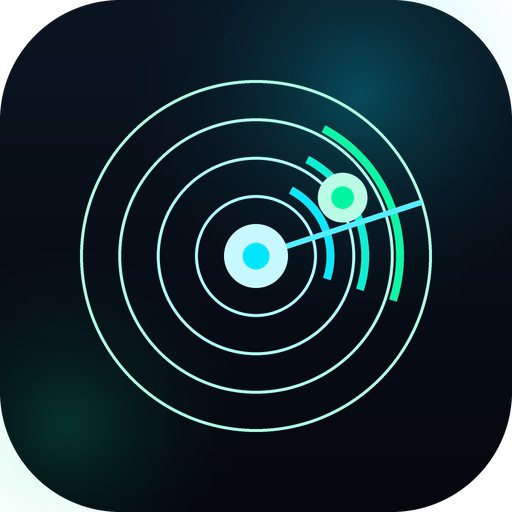

# RuView Wi-Fi · تطبيق أندرويد عربي للاستشعار عبر الواي فاي

<p align="center">
  
</p>

<p align="center">
  تطبيق Flutter جاهز للإنتاج، بواجهتين عربيتين (RTL) بالكامل، يتصل ببوابة
  <strong>RuView WiFi Sensing</strong> المحلية لمراقبة <strong>الحضور</strong>
  و<strong>الحركة</strong> و<strong>العلامات الحيوية</strong> — بدون أي كاميرات.
</p>

<p align="center">
  <code>Flutter 3.22+</code> · <code>MVVM</code> · <code>WebSocket + UDP</code> ·
  <code>Dark neon</code> · <code>بدون تبعيات ثقيلة</code>
</p>

<p align="center">
  تقدير وضعية الجسم (HAR) · بصمة مشية · كشف سقوط · وضع حراسة أمنية ·
  مراقبة النوم واضطراب التنفس
</p>

---

## ما هذا؟

عميل أصلي (Native) لبوابة RuView الرسمية. البوابة تقرأ تشويش موجات الواي فاي
عبر CSI من عُقد ESP32 وتستنتج: هل يوجد شخص؟ يتحرّك أم ساكن؟ ما معدل تنفسه؟
هذا التطبيق يعرض ذلك على الهاتف في لوحة تحكم ولوحة رصد حية.

**لا كاميرات، لا سحابة، لا بيانات تغادر شبكتك المحلية.**

## الواجهتان

### 1. لوحة التحكم
- بطاقة إعدادات الاتصال: عنوان IP، المنفذ، مبدّل بروتوكول (WebSocket/UDP)،
  وخيارات متقدمة (رمز `RUVIEW_API_TOKEN` واتصال `wss`).
- زر اتصال/قطع مع مؤشر حي (متصل · جاري الاتصال · إعادة محاولة · غير متصل).
- شرائح مباشرة: الهدف، مدة الاتصال، معدل التحديث (Hz).
- بطاقات ملخص: حالة النظام، العقد النشطة، الحضور الآن، الوضعية الحالية،
  جودة الإشارة.
- **وضع الحراسة الأمنية**: مفتاح تفعيل بنبض نيوني، آخر تنبيه، عدد التنبيهات،
  وتعديل رقم الطوارئ (997 افتراضيًا).
- زر بارز للانتقال إلى لوحة الرصد.

### 2. لوحة الرصد
- **رادار حضور مكاني** مرسوم بـ `CustomPainter`: حلقات، مسح دوّار، نقط حياة
  من مواضع `persons[].position` الحقيقية، وتسمية عربية واضحة.
- **لوحة العلامات الحيوية**: عدّاد تنفس قوسي (نفس/دقيقة) بحالة عربية
  (طبيعي/سريع/بطيء)، شدة الحركة كمقياس متدرّج، درجة الثقة، ورسم مصغّر للتاريخ.
- **بطاقة الوضعية الحالية (HAR)**: «الحالة الحالية: جالس» مع أيقونة متبدّلة،
  مصدر التقدير ودرجة الثقة، وهيكل عظمي مرسوم بـ `CustomPainter` من مفاصل
  الخادم (17 نقطة COCO) عند توفّرها.
- **بصمة المشية**: تعرّف على الشخص من إيقاع المشي (بدون كاميرا أو وجه)،
  مع تسجيل بصمات جديدة وحذفها وتشابه نسبي معلن.
- **لافتة طوارئ للسقوط**: تظهر أعلى الشاشة بلون أحمر نابض مع صوت واهتزاز
  وإشعار نظام، وزرّي «إلغاء الإنذار» و«اتصال بالطوارئ (997)».
- **لوحة النوم والعلامات الحيوية**: جودة النوم 0–100، متوسط التنفس وتصنيفه،
  تقلّب التنفس، وعدد اضطرابات التنفس (احتمال انقطاع النفس) مع تنبيه.
- **سجل الأنشطة والتنبيهات** في الأسفل: حضور، حركة، تنفس، إشارة، اتصال،
  وضعية، مشية، سقوط، أمني، نوم — بقواعد صريحة وحرّاس زمنية تمنع الإغراق،
  مع تصفية «الكل / أمني» لعرض «سجل الأنشطة الأمنية».

## الاتصال التلقائي على أي راوتر أو شبكة

لم يعد التطبيق مرتبطًا بعنوان ثابت. بمجرّد أن يرتبط الهاتف بأي شبكة واي فاي
يبدأ `LanScanner` بالبحث ثم يتصل تلقائيًا بلا أي إدخال يدوي:

1. **آخر اتصال ناجح** (محفوظ) → **بوابة الراوتر** (`.1`) → **عنوان الجهاز**.
2. مسح كامل لعناوين الشبكة `/24` على منافذ RuView الشائعة
   (`8765`, `3000`, `3001`, `8080`) بتوازٍ محدود وزمن إجمالي محكوم (7 ث).
3. فحص HTTP خفيف على كل منفذ مفتوح لتمييز خادم RuView عن أي منفذ آخر.
4. **تحقّق من وصول بيانات فعلية** قبل اعتماد الاتصال — لا يكفي فتح المقبس.
5. `NetworkWatcher` يراقب تغيّر الشبكة (عناوين IP فقط، بلا أذونات موقع) ويُعيد
   الاكتشاف فورًا عند الانتقال من شبكة إلى أخرى، مع إعادة محاولة متدرجة عند
   الانقطاع.

تبقى كل خيارات الإدخال اليدوي (عنوان/منفذ/رمز وصول/wss) متاحة في بطاقة
«إعدادات الاتصال» — التلقائي هو الافتراضي، واليدوي هو الاستثناء.

## التوأم الراديوي: جسم ثلاثي الأبعاد + غرفة

ست قدرات متقدمة مبنية داخل الشاشتين (بلا شاشات إضافية ولا حزم خارجية):

| القدرة | التنفيذ الفعلي في الكود |
|---|---|
| نموذج جسم بارامتري (SMPL) | `BodyShape` (10 معاملات β) + `BodyMeshBuilder` يبني شبكة أثلاثية الأبعاد (رؤوس/مثلثات/أسطح) من المفاصل — فتتغيّر الأكتاف والمحيطات والطول فعليًا |
| إكمال الشكل تنبئيًا | `ShapeCompleter`: توليد المفاصل الناقصة بسوابق أنثروبومترية + تماثل الجسم، ثم تنعيم Taubin (λ/μ) لإزالة ضجيج CSI مع حفظ الحجم |
| بصمة قياسات جسدية (توأم مسبق) | `BodySignature` + `BodyRecognizer` + `BodyProfileRepository`: يُحفظ الملف مرة واحدة ويُستدعى تلقائيًا في كل رصد (قياس + مشية) |
| قماش/عضلات ديناميكية | `ClothSimulator`: شبكة Verlet 7×5 مرتسية على الكتفين، تتأثر بحركة الجسم والرياح |
| إعادة بناء الغرفة (RF-SLAM) | `RoomReconstructor`: تراكم المكوّن الثابت من `signal_field`، فصل الساكن عن المتحرك بالتباين، شبكة إشغال 0.25 م، تجميع و تصنيف (كنبة/طاولة/خزانة/سرير/جدار/باب/نبات) |
| خامات واقعية بدل ألوان عشوائية | `MaterialLibrary`: كتان، بلوط، جوز، حجر، رخام، معدن، جلد، سيراميك — تُلبَس حسب نوع القطعة وتُعرض في مفتاح الخامات |

**حدود صريحة (شفافية هندسية):** التطبيق لا يشغّل شبكة انتشار (Diffusion)
بحجم غيغابايت على الهاتف؛ «الإكمال» و«التنعيم» يُنفَّذان بسوابق هندسية خفيفة
تعمل في الزمن الحقيقي على أجهزة متوسطة، والأشكال/الخامات إجرائية داخل Flutter
(`CustomPainter` بلا محرك 3D خارجي). القياسات **تقديرية** من انعكاسات CSI
وليست مسحًا طبيًا أو بيومتريًا معتمدًا.

## البدء السريع

```bash
# 1) تحضير المشروع
flutter create --platforms=android --org com.ruview .   # مرة واحدة (Gradle wrapper)
flutter pub get

# 2) تجربة فورية بلا أجهزة: بوابة محاكاة بنفس بروتوكول RuView الرسمي
node tools/mock_ruview_server.mjs --port 8080
#    ← معاينة الويب للتصميم:  http://localhost:8080/
#    ← للهاتف: أدخل IP جهاز الحاسوب والمنفذ 8080 ثم اضغط "اتصال"

# 3) تشغيل تطبيق الأندرويد
flutter run --release
```

دليل مفصّل (البناء، التوقيع، الاتصال ببوابة RuView الحقيقية، استكشاف الأخطاء):
[`docs/BUILD_AND_RUN.md`](docs/BUILD_AND_RUN.md)

### تنزيل APK جاهز من GitHub Actions

لا تحتاج Flutter على جهازك: كل دفعة إلى الفرع تُشغّل خط أنابيب
`.github/workflows/ci.yml` الذي يمرّ بأربع مراحل — تحليل ساكن، اختبارات، تدقيق
بنية Dart، ثم **بناء `app-release.apk`**.

1. افتح تبويب **Actions** في المستودع → أحدث تشغيل لـ `CI`.
2. من قسم **Artifacts** نزّل `ruview-wifi-apk` (يحتوي `app-release.apk`).
3. ثبّت الملف على الهاتف (اسم الحزمة `com.ruview.wifi`، الإصدار 1.2.0).

> الإصدار الحالي موقّع بمفتاح debug لتسهيل التجربة. للنشر الفعلي استبدله
> بمفتاحك كما في [`docs/BUILD_AND_RUN.md`](docs/BUILD_AND_RUN.md).
> وسم `v*` على المستودع ينشئ صفحة إصدار ويُرفق بها ملف APK تلقائيًا.

## لقطات التصميم

المعاينة الحيّة في `preview/` نسخة ويب مطابقة للتصميم (نفس الألوان والنصوص
واللوحات والرادار) تعمل على نفس بوابة المحاكاة — تُفتح على
`http://localhost:8080/` بعد تشغيل الخادم.

## هيكل المشروع

```
RuView-Wi-fi/
├── lib/                     كود تطبيق Flutter (MVVM)
│   ├── core/                الثيم، الألوان، النصوص العربية، الأدوات، التنقل
│   ├── data/                Models · Services (WS/UDP/CSI/تنبيهات) · Repository
│   ├── domain/monitoring/   تقدير الوضعية · السقوط · المشية · التسلل · النوم
│   └── presentation/        ViewModels · Screens · Widgets
├── test/                    اختبارات وحدة + ويدجت
├── android/                 مشروع أندرويد (Manifest، Gradle، الأيقونات)
├── preview/                 معاينة الويب للتصميم (HTML/CSS/JS بلا تبعيات)
├── tools/                   بوابة المحاكاة · سحب RuView الرسمي · مولّد الأيقونات
├── docs/                    البروتوكول · الهيكلية · البناء والتشغيل
└── vendor/ruview-official/  مقتطفات موثّقة من مشروع RuView الرسمي (MIT)
```

ملفات مهمة:

| الملف | الدور |
|---|---|
| [`lib/data/services/websocket_sensing_transport.dart`](lib/data/services/websocket_sensing_transport.dart) | عميل WebSocket: Bearer، إعادة اتصال أسّية، ping، رسائل أخطاء عربية |
| [`lib/data/services/udp_sensing_transport.dart`](lib/data/services/udp_sensing_transport.dart) | مستقبل UDP (JSON أو إطارات CSI) |
| [`lib/data/services/csi_analyzer.dart`](lib/data/services/csi_analyzer.dart) | فكّ إطار ESP32 (ADR-018) ومؤشرات محلية |
| [`lib/data/models/sensing_frame.dart`](lib/data/models/sensing_frame.dart) | نموذج `sensing_update` الرسمي + تسامح الحقول |
| [`lib/presentation/viewmodels/`](lib/presentation/viewmodels/) | `ConnectionViewModel` · `SensingViewModel` · قواعد الأحداث |
| [`lib/presentation/widgets/presence_radar.dart`](lib/presentation/widgets/presence_radar.dart) | الرادار الحي |
| [`lib/domain/monitoring/safety_monitor.dart`](lib/domain/monitoring/safety_monitor.dart) | المحرّك الموحّد: وضعية + سقوط + مشية + تسلل + نوم |
| [`lib/domain/monitoring/posture_estimator.dart`](lib/domain/monitoring/posture_estimator.dart) | تقدير الوضعية من الخادم ← الشخص ← المفاصل ← الحركة |
| [`lib/presentation/widgets/posture_status_card.dart`](lib/presentation/widgets/posture_status_card.dart) | بطاقة «الحالة الحالية» + الهيكل العظمي + بصمة المشية |
| [`lib/presentation/widgets/emergency_banner.dart`](lib/presentation/widgets/emergency_banner.dart) | لافتة السقوط الحمراء النابضة |
| [`lib/presentation/widgets/security_mode_card.dart`](lib/presentation/widgets/security_mode_card.dart) | مفتاح وضع الحراسة الأمنية |
| [`lib/presentation/widgets/sleep_vitals_panel.dart`](lib/presentation/widgets/sleep_vitals_panel.dart) | لوحة النوم والتنفس واضطراب النفس |
| [`tools/mock_ruview_server.mjs`](tools/mock_ruview_server.mjs) | بوابة محاكاة بلا تبعيات (WS + REST + معاينة) |

الهيكلية الكاملة وتدفّق البيانات: [`docs/ARCHITECTURE.md`](docs/ARCHITECTURE.md)

## البروتوكول المدعوم

- `ws://<host>:8765/ws/sensing` (وأيضًا على منفذ HTTP `3000`، أو `3001`).
- رسائل `sensing_update` بكامل حقولها الرسمية (`classification`, `features`,
  `vital_signs`, `persons`, `signal_field`, `estimated_persons` …) مع دعم
  الأسماء البديلة بين إصدارات البوابات.
- مصادقة `Authorization: Bearer <token>` على ترقية WebSocket (ADR-272).
- UDP `5005`: إطارات CSI الثنائية (magic `0xC5110001`) أو JSON مبثوث.
- REST للتحقق السريع: `/health`, `/api/v1/info`, `/api/v1/nodes`,
  `/api/v1/sensing/latest`, `/api/v1/vital-signs`.
- حقول الرصد المتقدم (اختيارية، تُقرأ بتسامح): `posture` و`persons[].pose`
  و`persons[].keypoints[].{name,x,y,z,confidence}`. التطبيق يعمل كاملًا
  حتى إن لم يرسلها الخادم (ينتقل إلى تقدير محلي من الحركة).

التفاصيل الكاملة مع الجداول: [`docs/PROTOCOL.md`](docs/PROTOCOL.md)

## مشروع RuView الرسمي

المرجع المعتمد هو [`ruvnet/RuView`](https://github.com/ruvnet/RuView) (رخصة MIT).
مقتطفات موثّقة (ADR-018/019/034/055/272 + `types.rs` + `LICENSE`) محفوظة في
[`vendor/ruview-official/`](vendor/ruview-official/PROVENANCE.md) على الالتزام
`5728b90`، وسحب المشروع كاملًا بأمر واحد:

```bash
./tools/fetch_official_ruview.sh          # → vendor/ruview-full (خارج Git)
```

## الاختبارات

```bash
flutter analyze
flutter test
python3 tools/check_dart_imports.py       # تدقيق استيرادات/أقواس سريع
```

يغطّي الاختبار تحليل الإطار الرسمي وكل الأسماء البديلة، تحقّق الإعدادات، فكّ
إطارات CSI الثنائية، قواعد الأحداث، تنعيم العلامات الحيوية، واجهة لوحة
التحكم (النصوص العربية + RTL + التنقل)، إضافةً إلى:

| الملف | ما يتحقق منه |
|---|---|
| `test/domain/posture_estimator_test.dart` | أولوية مصادر الوضعية + استنتاج المفاصل |
| `test/domain/fall_detector_test.dart` | نافذة الانتقال، عتبة الحركة، التهدئة |
| `test/domain/intrusion_detector_test.dart` | مهلة التسليح، التهدئة، المنطقة |
| `test/domain/gait_analyzer_test.dart` | نافذة المشي، المتجه، تشابه جيب التمام |
| `test/domain/sleep_monitor_test.dart` | النوم العميق، اضطراب النفس، الجودة |
| `test/domain/safety_monitor_test.dart` | دمج المحرّكات + الإشارات + التسجيل |
| `test/services/monitoring_settings_repository_test.dart` | حفظ الحراسة/الطوارئ/البصمات |
| `test/widget/monitoring_widgets_test.dart` | بطاقات الوضعية والنوم والحراسة والطوارئ |

## القيود وإخلاء المسؤولية

- معدل التنفس والنبض **تقديرات استنتاجية من CSI** وليست قياسات طبية معتمدة.
- مسار UDP المحلي (بدون بوابة) يستخدم مؤشرات مبسّطة في الهاتف؛ الدقة الكاملة
  تأتي من خادم RuView الرسمي عبر WebSocket.
- التطبيق مصمّم لشبكة محلية موثوقة (يسمح بـ `ws://` غير مشفّر لتلك الحالة).
- **تقدير الوضعية** يفضّل قيمة الخادم؛ الاستنتاج من المفاصل تخميني هندسي
  (heuristic) وليس نموذجًا عصبيًا عميقًا. **بصمة المشية** استرشادية بحدود
  تشابه معلنة، وليست تعريفًا بيومتريًا قضائيًا.
- **كشف السقوط** يفتح لوحة الهاتف على رقم الطوارئ فقط (`ACTION_DIAL`) ولا
  يتصل تلقائيًا، تجنّبًا للاتصالات الكاذبة. المستخدم يقرّر الإلغاء أو الاتصال.
- لا تُخزَّن سوى الإعدادات ومتجهات ميزات المشية (بلا صور/صوت/بيانات خام).

## الترخيص

كود هذا التطبيق متاح بموجب رخصة MIT. مقتطفات RuView المحفوظة في
`vendor/ruview-official/` تخضع لرخصة MIT الأصلية وحقوق (c) 2024 rUv.
